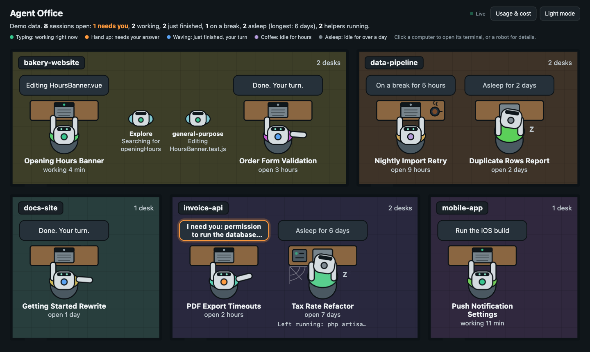
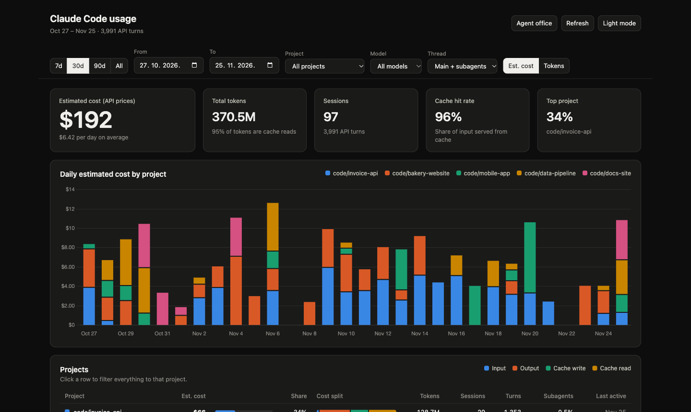
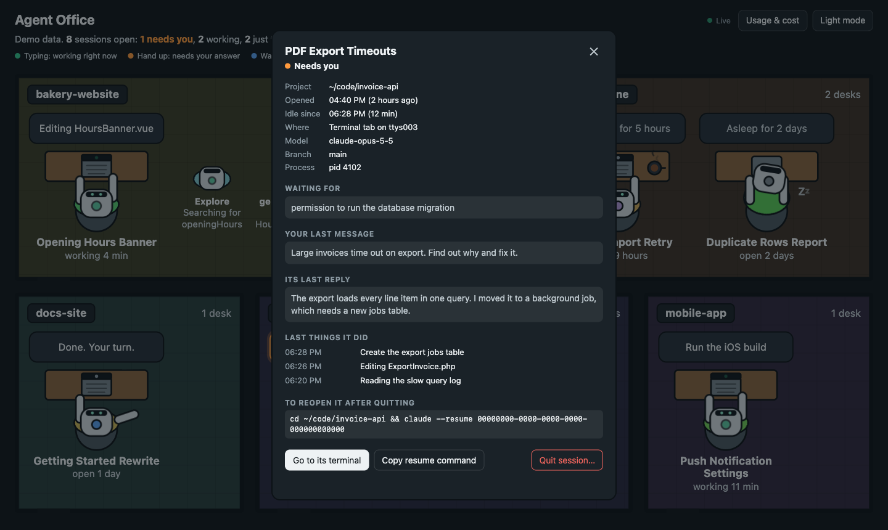

# Visual AI Agents

A local dashboard for [Claude Code](https://claude.com/claude-code). It shows every Claude session open on your machine as a robot in an office, and where your tokens go.



## Run it

You need [Node.js](https://nodejs.org) 22 or newer and Claude Code already in use on the machine.

```sh
git clone https://github.com/dseremet/visual-ai-agents.git
cd visual-ai-agents
```

As a desktop app (the server starts by itself when the app opens):

```sh
npm install
npm start             # opens the Agent Office window
npm run build         # builds dist/Agent Office-<platform>/Agent Office.app to keep in Applications
```

In the app menu, **Open at Login** makes it start with your computer. Closing the window keeps the app in the Dock.

### Install it as an app

There is no download to install: you build the app once on your own machine. `npm install` fetches Electron for you, so nothing else is needed.

```sh
npm install
npm run build
cp -R "dist/Agent Office-darwin-arm64/Agent Office.app" /Applications/
open "/Applications/Agent Office.app"
```

- On an Intel Mac the folder is `dist/Agent Office-darwin-x64`. The build prints the exact path when it finishes.
- After that, open **Agent Office** from Applications, Launchpad or Spotlight like any other app. No terminal has to stay open.
- The first time you click a computer, macOS asks whether Agent Office may control Terminal. Allow it, or the jump to the terminal tab will not work.
- To update: `git pull`, then run the build and copy steps again (quit the app first).

Or in a browser, with no install and no dependencies:

```sh
node server.js        # http://localhost:4747  (PORT=5000 node server.js to change)
```

- `http://localhost:4747/office` is the agent office.
- `http://localhost:4747/` is usage and estimated cost by project, session, model, subagent and tool.
- Add `?demo=1` to either address to try it with made-up data. The screenshots here were taken that way.

## Usage and cost



It reads `~/.claude/projects/**/*.jsonl` read-only, listens on 127.0.0.1 only, and re-parses only transcripts that changed since the last refresh.

- **Costs** are estimates at API list prices from `pricing.json`. Edit it when prices change or a new model shows up (unpriced models are flagged at the top of the page). On a Pro/Max plan the dollar figures show relative weight, not your bill.
- **Cross-check** in the footer compares the estimate with the cost Claude Code logs itself when a process exits (that log only covers the last run of a resumed session, so only those turns are compared).
- A turn is one API response; duplicate transcript records of the same response are merged by `message.id + requestId`.

## Agent office

`http://localhost:4747/office` shows every Claude Code session that is open on this machine as a character at a desk on a top-down floor plan, one room per project, refreshed every 3 seconds. The plan scales to the window so every room is visible without scrolling.



- **Who is shown:** sessions listed in `~/.claude/sessions/*.json` whose process is still alive, so a session left open for days still has a desk. Poses: typing (working), hand up (needs your answer), waving (finished in the last 30 minutes), coffee (idle for hours), asleep (idle over a day, cobwebs after 3 days). A small server box on the desk means it left a shell command running. Subagents that are still working sit next to their session.
- **Click the computer** on a desk to jump straight to that session's Terminal tab.
- **Click the robot** for what it last did, your last message, and three actions: bring its Terminal tab to the front (Terminal.app only; macOS asks once for permission to control Terminal), copy the `claude --resume` command, or quit the session (sends SIGTERM after a confirmation; the conversation stays resumable).
- The two actions only accept requests from this page, and only for pids that are registered Claude sessions.

The office was built and tested on macOS only. It reads the process list with `ps`, and bringing a tab to the front works with Terminal.app.

## Privacy

Everything stays on your machine. The server listens on 127.0.0.1 only, reads `~/.claude` and sends nothing anywhere. The usage page loads Chart.js from the jsDelivr CDN; nothing else is fetched from the network.
